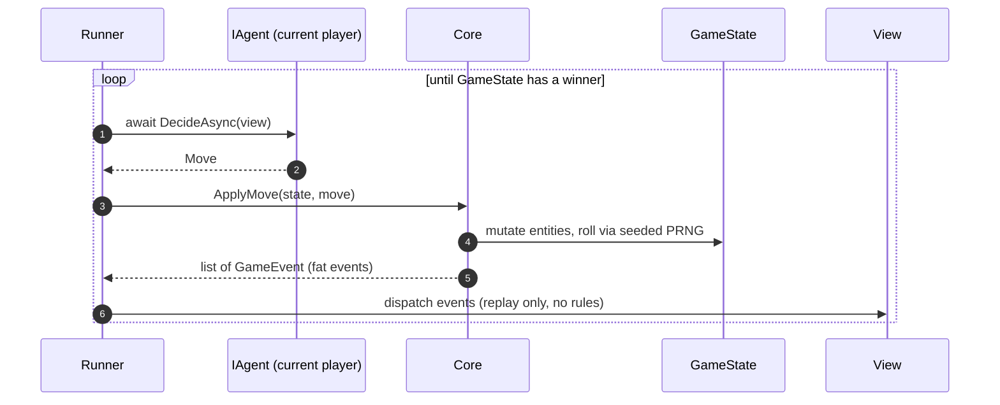

# Architecture Planning Research: How Architecture Is Planned and Documented

> **What decision this feeds.** The next ticket, *"Shape of the architecture spec"*, has to decide which C4 views Pantheon draws and in what notation (Mermaid-in-Markdown or HTML), whether to keep ADR files, where a glossary lives, and how to show a turn sequence. This note surveys how practitioners plan and document a software architecture before and while building it: the **C4 model**, **arc42**, **Architecture Decision Records (ADRs)**, **design docs and RFCs**, and **game-dev practice**. It then covers how a plan becomes a build order (**walking skeleton**, **tracer bullets**, **vertical slices**). For each technique it answers four questions: *what question does it answer, what artifact does it produce, what is its smallest useful size, and how do teams keep it in sync with the code?* Every non-obvious claim is cited inline. A source list is at the end.

> **Who this is for.** A backend developer who has always worked inside an existing architecture and never planned one from scratch. Terms are explained as they appear. One idea runs through the whole note: **architecture is the small set of decisions that are expensive to change. Write those down, and let the code document everything else.**

---

## Terms used in this note

| Term | Plain meaning |
|---|---|
| **Architecture** | The few structural decisions that are costly to reverse: what the big pieces are, where their boundaries sit, and how they talk (see §0). |
| **View / diagram** | One picture of the system from one angle (structure, runtime behaviour, deployment) at one zoom level. |
| **Model vs diagram** | A *diagram* is a drawing. A *model* stores the elements once as data and renders many diagrams from it. C4's FAQ says a modelling tool makes multi-diagram sets easier to keep consistent ([C4 FAQ](https://c4model.com/faq)). |
| **Seam** | A public interface where two parts meet and where tests attach. Pantheon's `AGENTS.md` already uses this word ([AGENTS.md](../../AGENTS.md)). |
| **ADR** | Architecture Decision Record: a short file recording one decision and why it was made (§3). |
| **Design doc / RFC** | A proposal for one change or feature, written before building it, so others can review the approach (§4). |
| **Slice** | A small piece of working behaviour that passes through every layer, top to bottom (§6). |

---

## 0. What counts as architecture, and where planning stops

This question comes first because it sets the stopping point for every technique below.

- **Architecture is "the important stuff".** Martin Fowler adopts Ralph Johnson's framing. Johnson treats architecture as the shared understanding expert developers have of a design, and as the decisions you *wish* you could get right early. His summary: "Architecture is about the important stuff. Whatever that is." ([Fowler, *Software Architecture Guide*](https://martinfowler.com/architecture/)).
- **"Important" means expensive to change.** Simon Brown cites Grady Booch: architecture is the set of significant design decisions, where "significance is measured by cost of change". Brown's examples of costly decisions are technology choices (language, framework) and structural choices (decomposition, modularity, functional boundaries). His example of detail that does *not* belong is a database column length ([Brown, *Software architecture isn't about big design up front*, 2020](https://dev.to/simonbrown/software-architecture-isn-t-about-big-design-up-front-4hol)).
- **When to stop up-front design.** Brown rejects both "big design up front" and "no design". He says to stop when the team understands the key drivers (requirements, quality attributes, constraints), the scope and context, and the significant technology and modularity decisions. The team should also be able to communicate the vision and should accept the remaining risks. He sizes this work in hours, days or weeks, not months. In practice it produces a System Context diagram and a Container diagram ([Brown 2020](https://dev.to/simonbrown/software-architecture-isn-t-about-big-design-up-front-4hol)).
- **Games add a warning against over-design.** Robert Nystrom says "architecture is about change": good structure is measured by how easily the code absorbs a change. Every abstraction layer costs code and mental load. He warns against speculative flexibility, meaning abstraction added for a need you may never have ([Nystrom, *Game Programming Patterns*: Architecture, Performance, and Games](https://gameprogrammingpatterns.com/architecture-performance-and-games.html)).
- **The documentation sources agree on the cut-off.** The C4 model advises against long-lived class-level (code) diagrams because an IDE can generate them on demand ([C4: Code diagram](https://c4model.com/diagrams/code)). arc42 says to keep detailed "whitebox" diagrams limited, because developers learn component internals from the code ([arc42 FAQ H-3](https://faq.arc42.org/questions/H-3/)). Google's design-doc guidance says not to paste API or schema definitions into a design ([Ubl, *Design Docs at Google*](https://www.industrialempathy.com/posts/design-docs-at-google/)).

**Rule of thumb for Pantheon (synthesis of the above).**

- **Is architecture:** the boundaries between Core, Runner, Agents and View. Sync Core versus async Runner. Who owns randomness. The *policy* that events are fat. The rule that Core has no Unity references. These are the seven locked decisions in [`AGENTS.md`](../../AGENTS.md), and each would be costly to reverse.
- **Is borderline:** the *shape* of `Move` and `GameEvent`. They are the wire protocol at the seam, so their general form is architecture. The full list of event types is not.
- **Is not architecture:** fields of `CardInstance`, enum member names, how `TakeDamage` works inside, and private helpers. The code and the tests already document these. A diagram or doc that repeats them goes stale.

---

## 1. The C4 model (Simon Brown)

**Question it answers:** *What are the pieces of this system, and how do they talk to each other, at each zoom level?*

**Artifact:** a small set of box-and-arrow diagrams, one per zoom level. Brown compares them to "maps of your code" that you zoom in and out of, like an online map. C4 is meant both for up-front design sessions and for documenting an existing codebase afterwards ([C4: Introduction](https://c4model.com/introduction)). It is notation-independent and tool-independent ([c4model.com](https://c4model.com/)).

### 1.1 The four levels, and what each one is *not*

| Level | Shows | Audience | Recommended? |
|---|---|---|---|
| **1. System Context** | Your system as one box, plus the people and external systems that touch it. No technology detail. | Everyone, technical or not | For all teams ([C4: System context](https://c4model.com/diagrams/system-context)) |
| **2. Container** | The separately running applications and data stores inside your system, and how they communicate. | Technical people inside and outside the team | For all teams ([C4: Container](https://c4model.com/diagrams/container)) |
| **3. Component** | The parts inside *one* container: groupings of related code behind a well-defined interface. | Architects and developers | Only "if you feel they add value" ([C4: Component](https://c4model.com/diagrams/component)) |
| **4. Code** | Classes and interfaces inside one component (UML class or ER diagram). | Developers | Advised against for long-lived docs. Generate it from the IDE, and only for the most important or complex components ([C4: Code](https://c4model.com/diagrams/code)) |

Two terms confuse newcomers:

- **A C4 "container" is not Docker.** It is a runtime boundary: something that must be *running* for the system to work. Examples are a desktop app, a mobile app, a web app, a console app, a database or a file system. A JAR, DLL or assembly is usually **not** a container. Those organise code *inside* a container ([C4: Container abstraction](https://c4model.com/abstractions/container)).
- **A C4 "component" is not a DLL or namespace.** It is "a grouping of related functionality encapsulated behind a well-defined interface", usually a set of classes behind an interface. Components are not deployed separately: all components of a container run in the same process. Namespaces, DLLs and folders *can* map one-to-one onto components, but they do not have to ([C4: Component abstraction](https://c4model.com/abstractions/component)).

The C4 diagrams page says "system context and container diagrams are sufficient for most software development teams", and you should draw only the levels that add value ([C4: Diagrams](https://c4model.com/diagrams)).

### 1.2 Supplementary diagrams

- **Dynamic diagram:** shows how the elements collaborate at runtime for one feature, story or use case. Steps are numbered to show their order. You can draw it as a free-form collaboration diagram or as a UML-style sequence diagram, because both carry the same information. C4 recommends using it sparingly, for recurring patterns or complicated interactions ([C4: Dynamic](https://c4model.com/diagrams/dynamic)). **A turn sequence is this kind of diagram.**
- **Deployment diagram:** maps containers onto infrastructure for one environment, such as production, staging or dev ([C4: Deployment](https://c4model.com/diagrams/deployment)). The container diagram deliberately leaves out clustering, load balancers and failover, and sends them here ([C4: Container](https://c4model.com/diagrams/container)).
- **System landscape:** many systems at once, for organisations that run many systems ([c4model.com](https://c4model.com/)).
- **Not covered by C4:** state machines, workflows and business processes. C4 covers static structure. Its FAQ suggests UML or other notations for those ([C4 FAQ](https://c4model.com/faq)).

### 1.3 Notation rules (regardless of tool)

Each diagram should make sense on its own, without a narrator. The C4 notation page asks for:

- a title that names the diagram type and scope;
- a key (legend) that explains shapes, colours, line styles and arrowheads;
- an explicit type on every element (Person, Software System, Container, Component), a short responsibility description, and a technology for every container and component;
- one-way arrows, each labelled with a specific verb phrase rather than a vague "uses". Container-to-container arrows also name the protocol.

Colours are up to you, but use them consistently and make sure the diagram still reads in black and white ([C4: Notation](https://c4model.com/diagrams/notation)).

### 1.4 Smallest useful size

Two diagrams: System Context and Container ([C4: Diagrams](https://c4model.com/diagrams)). Add a Component diagram only where it earns its keep. Add a dynamic diagram for the one or two flows people keep asking about.

### 1.5 Keeping it in sync

- C4's tooling page lists the questions to ask when choosing tools. Should diagrams be stored as code, in git next to the source? Is the format easy to diff in a pull request? Are the diagrams short-lived (whiteboard) or long-lived documentation? It suggests a whiteboard for collaborative design sessions and proper tooling for long-lived docs ([C4: Tooling](https://c4model.com/tooling)).
- For long-lived component diagrams, C4 suggests automating their creation ([C4: Component](https://c4model.com/diagrams/component)).
- The higher levels change rarely, so they are cheap to maintain. arc42 makes the same point about its top-level view (§2.4).

### 1.6 C4 as text: Mermaid

- **Mermaid** has C4 syntax for System Context, Container, Component, Dynamic and Deployment diagrams, compatible with C4-PlantUML ([Mermaid: C4 diagrams](https://mermaid.js.org/syntax/c4.html)).
- **Limits:** the layout is not fully automatic. Shapes are placed in the order you write the statements, and layout hints such as `Lay_U` are not planned. Styling is fixed. `Legend`, sprites, tags and links are not supported in the short term ([Mermaid: C4 diagrams](https://mermaid.js.org/syntax/c4.html)). The missing legend matters, because C4's notation rules ask for a key. With Mermaid C4 you would write the key as a Markdown table under the diagram.
- **Mermaid sequence diagrams** support participants, activations, notes, `loop`/`alt`/`opt`/`par` blocks and automatic step numbering ([Mermaid: Sequence diagrams](https://mermaid.js.org/syntax/sequenceDiagram.html)). That covers what a C4 dynamic diagram in sequence style needs.
- **GitHub renders Mermaid** in Markdown files, issues, pull requests, discussions and wikis, from a fenced code block tagged `mermaid`. GitHub does not publish which Mermaid version it runs. You can check by rendering a block that contains only `info` ([GitHub Docs: Creating diagrams](https://docs.github.com/en/get-started/writing-on-github/working-with-advanced-formatting/creating-diagrams)).

### 1.7 Mapping C4 onto Pantheon (the tricky part)

C4 targets custom-built software systems, monolithic or distributed. Its FAQ suggests UML may suit libraries and SDKs better, or a C4 diagram of one *example use* of the library ([C4 FAQ](https://c4model.com/faq)). Pantheon's heart is a library: `Pantheon.Core` is a DLL referenced by both the Unity client and the future `Pantheon.Server` ([AGENTS.md, decision 7](../../AGENTS.md)). Under C4's definitions, a DLL is code organisation, not a container. Applied to Pantheon (synthesis):

| C4 level | Pantheon content | Value now |
|---|---|---|
| Context | Players → Pantheon. Later, an identity platform (Steam or a BaaS), which `AGENTS.md` places outside the engine. | Low but cheap. It marks where the system ends. |
| Container | MVP: one headless test/console host. Planned: the Unity client app and `Pantheon.Server` (.NET), *each embedding* `Pantheon.Core`. Server marked "parked". | Medium. It shows "one Core, many builds" at a glance. |
| Component | Inside the host process: Runner, `IAgent` and its implementations, the Core step functions (`StartGame`/`GetValidMoves`/`ApplyMove`), `GameState` with its PRNG and event log, and the View boundary. | **High.** Most of Pantheon's locked decisions live at this level. |
| Dynamic | One turn: Runner → Agent → Core → GameState → events → View. | **High.** This is the flow `docs/architecture/overview.html` already draws. |
| Code | Classes. | Skip. The IDE and the tests cover it. |
| Deployment | Server container in the cloud. | Skip until server work resumes. |

So Pantheon is unusual. For most teams C4 recommends Context and Container and makes Component optional. For Pantheon, the Component and Dynamic views carry the most information.

---

## 2. arc42 (Gernot Starke, Peter Hruschka)

**Question it answers:** *What should architecture documentation contain, and in what order?* arc42 is a fill-in template with 12 sections. It is not a diagram notation.

**Artifact:** one document (or a folder of documents) with these sections ([arc42 overview](https://arc42.org/overview)):

1. Introduction & Goals: key requirements and the top quality goals.
2. Constraints: limits on the design, regulatory or otherwise.
3. Context & Scope: external systems and interfaces. *Same idea as C4 System Context.*
4. Solution Strategy: the main ideas behind the solution.
5. Building Block View: the code structure, refined level by level. *Same idea as C4 Container/Component.*
6. Runtime View: key scenarios of the system at runtime. *Same idea as a C4 dynamic diagram.*
7. Deployment View: infrastructure and deployment. *Same idea as C4 Deployment.*
8. Crosscutting Concepts: patterns and rules that apply across the system.
9. Architecture Decisions: important decisions, unless recorded elsewhere. *ADRs (§3) usually go here or are linked from here.*
10. Quality Requirements: a quality tree and concrete quality scenarios.
11. Risks & Technical Debt.
12. Glossary: domain terms, the "ubiquitous language".

The italic mappings to C4 are my synthesis. arc42's own FAQ only says the two overlap in several sections. It also says C4 leaves out quality requirements, crosscutting concepts and risks ([arc42 FAQ B-17](https://faq.arc42.org/questions/B-17/)).

### 2.1 Smallest useful size

- The arc42 authors say there is no general rule. The minimum depends on the system's stakeholders, criticality, size and risk. As a starting point they suggest: 3–5 central quality requirements written as scenarios, the context view, a short solution strategy with the most important decisions, a level-1 building block view, and the most important crosscutting concepts ([arc42 FAQ B-4](https://faq.arc42.org/questions/B-4/)).
- Do not fill every section by default. Write "only what your stakeholders need", because every section you write is something you must maintain ([arc42 FAQ B-1](https://faq.arc42.org/questions/B-1/)).
- For something lighter than twelve sections, arc42 offers a one-page "canvas" ([arc42 overview](https://arc42.org/overview)).

### 2.2 Runtime view: how to show a flow

arc42 ranks three ways to describe a runtime scenario, from least to most effort ([arc42 FAQ C-6-3](https://faq.arc42.org/questions/C-6-3/)):

1. a numbered list of steps in plain text, naming the building block that does each step;
2. an activity diagram or flowchart with swim-lanes;
3. a UML sequence diagram, which costs the most to create and maintain but maps building blocks to actions best.

### 2.3 Glossary

arc42 keeps the glossary as a table limited to relevant terms, with no trivia, and gives it a named owner ([arc42 FAQ C-12-2](https://faq.arc42.org/questions/C-12-2/)). This is the Domain-Driven Design idea of a *ubiquitous language*: one precise vocabulary that developers and domain experts share, which changes as understanding improves ([Fowler, *UbiquitousLanguage*](https://martinfowler.com/bliki/UbiquitousLanguage.html)).

### 2.4 Keeping it in sync

arc42's advice ([arc42 FAQ H-3](https://faq.arc42.org/questions/H-3/)):

- Give the documentation **one owner**.
- Keep it lean.
- Concentrate on the top-level building blocks, which rarely change: "Many source code changes don't affect level-1!"
- For parts that are still changing, write abstractly, or wait until they settle.
- Prefer crosscutting concepts (section 8). They outlast detailed building-block and runtime descriptions.

**Pantheon fit:** do not adopt arc42 as a template. A 3-person project does not need twelve sections. Use it as a **checklist** of what an architecture doc can contain. Its *quality scenarios* idea is worth borrowing (§8).

---

## 3. Architecture Decision Records (ADRs)

**Question it answers:** *Why is the system built this way, and what did we give up?* Other tools describe structure. ADRs record **reasons**.

### 3.1 Nygard's original format (2011)

Michael Nygard's problem: new team members cannot see why past decisions were made. So they either accept them blindly, even when the reasons no longer hold, or reverse them blindly and damage something they did not understand. Large specification documents do not help, because nobody reads them and they go out of date. His answer is small, modular records ([Nygard, *Documenting Architecture Decisions*, 2011](https://cognitect.com/blog/2011/11/15/documenting-architecture-decisions)):

- **Sections:**
  - **Title:** a short noun phrase.
  - **Context:** the forces at play (technical, political, social, project), stated as neutral facts.
  - **Decision:** full sentences in active voice, usually starting "We will…".
  - **Status:** proposed, accepted, deprecated, or superseded with a link to the replacement.
  - **Consequences:** all resulting effects, good, bad and neutral.
- **Size:** one or two pages, written as prose for future developers.
- **Location:** in the repository, as `doc/arch/adr-NNN.md` in lightweight markup.
- **Numbering:** sequential, and numbers are never reused.
- **Superseding:** when a decision is reversed, the old ADR **stays** and is marked superseded. Knowing what you used to decide is still useful.
- **What deserves one:** decisions that affect structure, non-functional characteristics, dependencies, interfaces or construction techniques.

### 3.2 Variants

- **Vocabulary** ([adr.github.io](https://adr.github.io/)):
  - *AD* (architectural decision): a justified design choice that addresses an architecturally significant requirement.
  - *ASR* (architecturally significant requirement): a requirement that measurably affects the architecture.
  - *Decision log:* the collection of a project's ADRs.
- **MADR 4.0.0** (Markdown Architectural Decision Records, released 2024-09-17):
  - Required sections: title, context and problem statement, considered options, decision outcome.
  - Optional sections: decision drivers, consequences, confirmation, pros and cons of each option, more information.
  - Optional front matter: status, date, decision-makers, consulted, informed.
  - Files live in `docs/decisions/NNNN-title-with-dashes.md`.
  - Source: [MADR](https://adr.github.io/madr/).
- **Y-statement:** one sentence: *In the context of ⟨use case⟩, facing ⟨concern⟩, we decided for ⟨option⟩ to achieve ⟨quality⟩, accepting ⟨downside⟩.* A long form adds the rejected options and an extra "because…" ([ADR templates](https://adr.github.io/adr-templates/)).
- **Tooling:** `adr-tools` is a shell CLI. `adr init` creates the log (default directory `doc/adr`), `adr new <title>` creates a numbered file, and `adr new -s <n> <title>` creates a new ADR that supersedes number *n* and marks the old one ([npryce/adr-tools](https://github.com/npryce/adr-tools)).
- **Local convention:** `AGENTS.md` suggests the `mattpocock-skills:domain-modeling` skill when shaping `Move`, `GameEvent` or the Core seams. That skill expects ADRs in `docs/adr/0001-slug.md`, created only when the first one is needed. It allows a single paragraph. It only proposes an ADR when the decision is hard to reverse, would surprise a future reader, and came from a real trade-off (local skill file `domain-modeling/ADR-FORMAT.md`).

### 3.3 Smallest useful size

One sentence (Y-statement) or one paragraph. Nygard's upper bound is two pages.

### 3.4 Keeping it in sync

An ADR is a **dated record of a decision**, not a description of the current code. You do not update it to match the code. When the decision changes, you write a new ADR and mark the old one superseded ([Nygard 2011](https://cognitect.com/blog/2011/11/15/documenting-architecture-decisions); [adr-tools](https://github.com/npryce/adr-tools)). So ADRs go stale much less than diagrams do. The only field that changes is the status.

### 3.5 Pantheon fit

The seven "LOCKED" items in [`AGENTS.md`](../../AGENTS.md) are already ADRs in compressed form: each has a decision, a *why* and a *don't*. Two pieces are missing:

- **Status and supersede history.** Decision 7 (server) is already "parked", which is a status in all but name.
- **Room for context and rejected options.** For some decisions this lives in `docs/research/*.md`.

Example, decision 2 written as a Y-statement:

> *In the context of AI search, replays and tests, facing the need for reproducible games, we decided for one seeded PRNG owned by `GameState` to achieve `pure(seed, moves)` determinism, accepting that no code may ever call `System.Random` or `UnityEngine.Random` directly.*

---

## 4. Design docs and RFCs

**Question it answers:** *How should we build **this** feature or change, and what are the alternatives?* A design doc is a **proposal** for one piece of work, written before coding and reviewed by peers. C4 and arc42 describe the system as it is. A design doc argues for a change.

### 4.1 Google-style design docs

Malte Ubl (ex-Google) describes them as informal documents written before coding. They record the high-level implementation strategy and the key decisions, with emphasis on trade-offs ([Ubl, *Design Docs at Google*](https://www.industrialempathy.com/posts/design-docs-at-google/)). From that article:

- **Typical sections:**
  - context and scope;
  - goals and **non-goals** (reasonable goals deliberately left out);
  - the design, starting with an overview and possibly a system-context diagram;
  - **alternatives considered**, which Ubl rates as one of the most important sections;
  - crosscutting concerns such as security, privacy and observability.
- **Form:** his first rule is to "Write them in whatever form makes the most sense" for the project.
- **Size:** 10–20 pages for a large project. A **mini design doc of 1–3 pages** suits incremental work.
- **When *not* to write one:** when the solution is not ambiguous. Another warning sign is a doc that reads like an implementation manual, with no trade-offs or alternatives. A prototype can sometimes replace the doc.
- **Lifecycle:** draft and iterate → review (comment threads, or a meeting) → implement, updating the doc as reality changes → maintenance and learning.
- **Staleness:** design docs drift from reality like all documentation. Authors tend to write amendment docs rather than edit the original, so the original should link to the later changes.

*Software Engineering at Google*, ch. 10 (written by Tom Manshreck, edited by Riona MacNamara) adds ([SWE at Google, ch. 10](https://abseil.io/resources/swe-book/html/ch10.html)):

- Most Google teams require an **approved** design doc before a major project starts. After approval it serves as a historical record and as a yardstick for whether the project met its goals.
- **Every doc needs an owner**, because unowned docs go stale. Google uses "last reviewed" freshness dates and sends reminders when a doc goes untouched for a while, for example three months.
- Important documentation should sit **in source control next to the code**, go through code review, and be updated in the same change as the code. The chapter's guiding idea is to treat documentation like code.

### 4.2 RFCs (Request for Comments)

- **Rust's RFC process** covers "substantial" changes only; bug fixes and refactors are excluded. The steps:
  1. copy a template into `text/0000-my-feature.md`;
  2. open a pull request;
  3. discuss and revise;
  4. run a ten-day final comment period (FCP) before merge, close or postpone.

  After acceptance, only minor amendments are allowed. A substantial change needs a new RFC, with a note on the old one. Acceptance does not guarantee the feature gets built ([rust-lang/rfcs](https://github.com/rust-lang/rfcs)).
- **Oxide's RFDs (Requests for Discussion)** are stored in git and reviewed by pull request. They move through these states: prediscussion → ideation → discussion → **published** (discussion has converged and the RFD is merged) → **committed** (the idea is implemented, so the RFD now describes how the system works), or abandoned. An RFD can start rough. It becomes authoritative only as it reaches published and committed ([Oxide RFD 1](https://rfd.shared.oxide.computer/rfd/0001)).

### 4.3 Smallest useful size and sync

- **Size:** 1–3 pages for a mini design doc.
- **Sync:** design docs are usually **frozen after they ship**, like ADRs. Changes come as amendments or new RFCs, not as edits to the original. Oxide's "committed" state is the exception: there the document becomes a description of the live system.

### 4.4 Pantheon fit

Pantheon already works this way, without the name:

- `docs/research/*.md` are investigation notes that feed a decision.
- [`docs/architecture/overview.html`](../architecture/overview.html) calls itself "a draft for the team to argue with". That is a design doc or RFD in the "discussion" state.

A mini design doc is worth writing only for genuinely ambiguous work: the effect system (Battle Cry and Deathrattle triggers), the shape of `Move` and `GameEvent`, and AI search. It is not worth writing for work with an obvious answer.

---

## 5. Game-dev-specific practice

No game-industry *architecture documentation* standard turned up in this research; see the gaps section. What games do have is a design-document tradition and a milestone vocabulary.

- **Game design document (GDD) and technical spec.** Tim Ryan's 1999 Gamasutra series is a classic reference. Part 1 covers the concept and proposal: the vision, the contents, and a plan to build it ([Ryan, *Anatomy of a Design Document*, Part 1](https://www.gamedeveloper.com/design/the-anatomy-of-a-design-document-part-1-documentation-guidelines-for-the-game-concept-and-proposal)). Part 2 splits the rest into two documents ([Ryan, Part 2](https://www.gamedeveloper.com/design/the-anatomy-of-a-design-document-part-2-documentation-guidelines-for-the-functional-and-technical-specifications)):
  - a **functional spec**: what the game does, from the player's point of view;
  - a **technical spec**, "a working blueprint for the game": how it is built, from the system's point of view.

  The technical spec covers the platform and external libraries, the code objects, the control loop between startup, shell and gameplay, data structures and data flow, AI, networking, UI and the graphics and audio engines. The lead programmer writes it, with each area's programmer writing their part. It is detailed enough to estimate tasks from, and it mirrors the functional spec so that every feature is covered. Ryan also recommends making physics and AI values data-driven, so designers can tune them without code changes. **For Pantheon:** [`docs/design.md`](../design.md) is the GDD and functional spec. The architecture spec is the technical spec, kept much leaner than Ryan's 1999 version, which predates agile and docs-as-code practice.
- **Pre-production and the game-dev "vertical slice".** A practitioner article on Game Developer describes the outputs of pre-production ([Florencio, *What you should take out of pre-production*, 2022](https://www.gamedeveloper.com/game-platforms/what-you-should-take-out-of-pre-production)):
  - prototypes that test the core systems and look for what is fun;
  - a **vertical slice**, defined there as a small cross-section of the game with a bit of every core part (art, gameplay, systems), which validates the gameplay before full production;
  - defined pipelines and conventions;
  - living GDD and TDD documents, kept current through the team's Definition of Done.
- **Terminology trap.** In game production, "vertical slice" usually means a **polished, representative chunk of the finished game**, often used to win approval or funding. In agile, it means a **thin end-to-end increment of functionality** (§6.3). Pantheon's `AGENTS.md` uses the agile meaning ("vertical slices (one test → one impl → repeat)"). Say which one you mean when you talk to game-dev people.
- **Architecture advice written for games.** Nystrom (above) argues for decoupling only where change is likely, and for prototype code that really gets thrown away ([Nystrom](https://gameprogrammingpatterns.com/architecture-performance-and-games.html)). His turn-based game loop shows the same separation Pantheon locked: the loop asks the current actor for an action object (Command pattern) and then performs it. When the hero has no queued action, the loop returns control to the UI instead of blocking. That keeps input code out of the engine ([Nystrom, *A Turn-Based Game Loop*, 2014](https://journal.stuffwithstuff.com/2014/07/15/a-turn-based-game-loop/)). Pantheon gets the same decoupling with `await IAgent.DecideAsync` instead of polling ([AGENTS.md, decision 5](../../AGENTS.md)).

---

## 6. From plan to build order

Planning produces boxes, seams and decisions. To turn that into a build order, practitioners use three related ideas.

### 6.1 Walking skeleton (Alistair Cockburn)

Cockburn defines a walking skeleton as a tiny implementation of the system that performs one small function end to end. It "need not use the final architecture", but it must connect the main architectural components. After that, architecture and functionality evolve in parallel ([Cockburn, *Walking skeleton*, archived 2008](http://web.archive.org/web/20080511171042/http://alistair.cockburn.us:80/index.php/Walking_skeleton)).

- **Origin story:** a team building systems that passed messages around a ring. In week one they made a single *null* message travel the whole ring. After that, the ring had to stay intact at the end of every week ([same page](http://web.archive.org/web/20080511171042/http://alistair.cockburn.us:80/index.php/Walking_skeleton)).
- **Pairing:** Cockburn pairs it with *Incremental Rearchitecture*, which means improving the architecture while features are added on top of the skeleton ([same page](http://web.archive.org/web/20080511171042/http://alistair.cockburn.us:80/index.php/Walking_skeleton)).
- **Use with TDD:** the C2 wiki entry, which quotes Cockburn's definition, adds that a walking skeleton is a way to kick-start test-driven development ([C2 wiki: WalkingSkeleton](https://wiki.c2.com/?WalkingSkeleton)).

### 6.2 Tracer bullets (Hunt & Thomas, *The Pragmatic Programmer*)

- **Where it appears:** Topic 12 of the 20th-anniversary edition ([O'Reilly listing](https://www.oreilly.com/library/view/the-pragmatic-programmer/9780135956977/f_0030.xhtml)).
- **The metaphor:** tracer rounds in gunnery. You fire, watch where they land, and adjust while the target moves.
- **In code:** a thin skeleton that runs end to end through every layer (UI, logic, storage) while doing very little. It is **kept and grown** one feature at a time, and each new feature checks that the pieces still fit.
- **Prototypes are different:** a prototype is a narrow experiment that answers one question and is then thrown away. In Hunt's words, "Prototypes are for your learning."
- **When it doesn't fit:** when requirements are fixed and well understood, detailed up-front specification can be cheaper.
- Source for the last four points: Hunt and Thomas interviewed by Bill Venners, 2003 ([Artima, *Tracer Bullets and Prototypes*](https://www.artima.com/articles/tracer-bullets-and-prototypes)).

Tracer bullets and walking skeletons are essentially the same idea. A **spike** or **prototype** is the separate tool for answering one question with throwaway code. AGENTS.md lists `mattpocock-skills:prototype` for this.

### 6.3 Vertical slices

- **The idea:** Bill Wake's INVEST article pictures a story as a layered cake (network, persistence, logic, presentation). His advice is to "slice vertically through the layers": every story should cross all the layers. A finished database layer on its own gives a user nothing ([Wake, *INVEST in Good Stories*, 2003](https://xp123.com/articles/invest-in-good-stories-and-smart-tasks/)).
- **Practice:** Cockburn's *Elephant Carpaccio* exercise trains teams to cut very thin slices of this kind. Henrik Kniberg published a facilitation guide for it ([Kniberg, *Elephant Carpaccio facilitation guide*, 2013](https://blog.crisp.se/2013/07/25/henrikkniberg/elephant-carpaccio-facilitation-guide)).

### 6.4 How the pieces combine (synthesis)

1. **Plan** just enough to name the components and seams: a Component diagram plus ADRs (§0, §1).
2. **Build a walking skeleton:** one trivial behaviour that touches every component, wired together, with a test.
3. **Add vertical slices,** one behaviour at a time, each test-first at a seam. Change the architecture only when a slice shows it is wrong, and record that change as a new ADR.
4. **Spike or prototype** separately whenever one question blocks a slice, then throw the code away.

### 6.5 What this looks like for Pantheon (illustrative, not decided)

[`MVP.md`](../../MVP.md) is done when a match goes start → play → finish with a winner, driven by AI, and Battle Cry and Deathrattle both fire. A possible order:

1. **Skeleton:** `StartGame` → the Runner awaits a stub agent → the agent returns one trivial `Move` (for example *end turn* or *concede*) → `ApplyMove` mutates `GameState` and returns a fat event → the Runner detects a winner and stops. This one path touches the Runner, `IAgent`, the Core step function, `GameState`, the event log and the seeded PRNG (if the deck is shuffled at start). It matches the seams `AGENTS.md` lists as next: the `RunAsync()` loop and where `ApplyMove` lives.
2. **Slice:** draw a card at turn start (deck, hand and PRNG).
3. **Slice:** play the vanilla 2/3 creature (with mana, per [`design.md`](../design.md)).
4. **Slice:** attack a creature or the hero; a hero at 0 HP gives the real win condition.
5. **Slice:** Battle Cry (`OnPlay`).
6. **Slice:** Deathrattle (`OnDeath`).
7. **Slice:** a basic AI that uses `Clone()` (clone → apply → score → discard) in place of the stub agent.

Each step is one red test, then green, at a public seam (`ApplyMove`/`GetValidMoves` or the Runner).

---

## 7. Comparison

| | **C4** | **arc42** | **ADR** | **Design doc / RFC** | **Game GDD / tech spec** |
|---|---|---|---|---|---|
| **Question** | What are the pieces, and how do they connect, per zoom level? | What should architecture docs contain? | Why did we choose this, and what did it cost? | How should we build *this change*, versus the alternatives? | What is the game (GDD), and how is it built (tech spec)? |
| **Artifact** | 2–4 box-and-arrow diagrams, plus optional dynamic and deployment diagrams | A 12-section document, or a one-page canvas | One small file per decision, in a numbered log | One proposal document per change | Design doc, functional spec, technical spec |
| **Smallest useful size** | Context + Container ([C4](https://c4model.com/diagrams)) | Quality scenarios, context, strategy, level-1 blocks, key concepts ([B-4](https://faq.arc42.org/questions/B-4/)) | One sentence (Y-statement) or one paragraph | 1–3 page mini doc ([Ubl](https://www.industrialempathy.com/posts/design-docs-at-google/)) | Pantheon's `design.md` is already one |
| **Lifespan** | Living: must track the code | Living | Immutable history: superseded, not edited | Frozen after review; amended, or "committed" (Oxide) | Living (DoD-maintained, per [Florencio](https://www.gamedeveloper.com/game-platforms/what-you-should-take-out-of-pre-production)) |
| **How kept in sync** | Diagrams as code in git, diffable in PRs; draw only the stable levels; automate component diagrams | One owner; document level-1 only; defer volatile parts | New ADR supersedes the old one; only the status field changes | Link amendments from the original; or promote it to "committed" | Same-change doc updates via the Definition of Done |
| **Stops at** | The component level; code is left to the IDE | Whatever stakeholders need | Decisions that are hard to reverse | Unambiguous work needs no doc | — |
| **Fit for Pantheon** | **Yes:** Component + Dynamic views matter most | **As a checklist only** | **Yes**, short form | **Mini docs**, only for ambiguous features | `design.md` = GDD; the architecture spec = a lean tech spec |

These tools work together. arc42 is the table of contents. C4 provides the pictures for arc42 sections 3, 5, 6 and 7. ADRs fill section 9. A design doc is how a new decision gets argued before it becomes an ADR.

---

## 8. What fits Pantheon: a recommended minimum kit

This is a starting position for the "Shape of the architecture spec" ticket to accept or overturn.

### 8.1 Files

```
AGENTS.md                          map + one-line summary per locked decision, linking to its ADR (exists)
GLOSSARY.md                        domain terms only (new)
docs/architecture/README.md        the architecture spec: Mermaid diagrams + short prose (new)
docs/architecture/overview.html    the explainer page; becomes a dated snapshot or is regenerated (exists)
docs/adr/0001-….md … 0007-….md     the 7 locked decisions, backfilled in short form (new)
docs/design.md                     game design = GDD / functional spec (exists)
docs/research/*.md                 investigations behind decisions (exists)
```

### 8.2 Which C4 views to draw

1. **System Context.** Tiny: Player(s) → Pantheon. Show the identity platform (Steam or BaaS) dashed and labelled "out of engine / later". It is cheap, and it shows where the system ends.
2. **Container.** The MVP headless host. The Unity client and `Pantheon.Server`, both marked as planned or parked. Each one *embeds* `Pantheon.Core`. Draw Core as a library inside each container, not as its own container ([C4 container definition](https://c4model.com/abstractions/container)).
3. **Component (Core + Runner).** **This is the main diagram.** It shows the Runner, `IAgent` with its implementations, the Core step functions, `GameState` (with its PRNG and event log) and the View boundary. Label the arrows with the real calls (`DecideAsync`, `ApplyMove`, "dispatches `List<GameEvent>`").
4. **Dynamic: one turn** (§8.5).
5. **Skip** the Code level (IDE and tests cover it) and Deployment (until the server is unparked).

### 8.3 Notation: Mermaid in Markdown as the source of truth

**Why Mermaid in Markdown:**

- It is text in git, so it diffs in pull requests. That answers the questions C4's tooling page asks ([C4: Tooling](https://c4model.com/tooling)).
- GitHub renders it in the browser ([GitHub Docs](https://docs.github.com/en/get-started/writing-on-github/working-with-advanced-formatting/creating-diagrams)).
- Any team member or agent can edit it without hand-placing SVG coordinates.

**The cost:**

- Mermaid's C4 syntax lays shapes out in statement order and has no `Legend` ([Mermaid C4](https://mermaid.js.org/syntax/c4.html)).
- So add a key table under each diagram, as the C4 notation rules require ([C4: Notation](https://c4model.com/diagrams/notation)).
- If C4 syntax lays out badly, use a plain Mermaid `flowchart` with subgraphs.

**Keeping the HTML page:** the hand-drawn SVG in `overview.html` looks better and is the better *explainer*. But two hand-maintained copies of the same diagram will drift. The next ticket should pick **one source of truth**. The suggestion: the Markdown spec is canonical, and `overview.html` is either marked as a dated snapshot or regenerated from it.

### 8.4 ADRs

**Yes.** Use `docs/adr/NNNN-slug.md`, which matches the `domain-modeling` skill that `AGENTS.md` already recommends.

- **Format:** short. Nygard's five headings, or a single Y-statement paragraph, are both fine.
- **Backfill 0001–0007** from the locked list in `AGENTS.md`, roughly one paragraph each. Mark 0007 (server) as accepted-but-parked.
- **AGENTS.md** keeps a one-line summary plus a link for each, so it stays "the map, not the territory".
- **Changing a decision:** write a new ADR and mark the old one superseded. Never rewrite history ([Nygard](https://cognitect.com/blog/2011/11/15/documenting-architecture-decisions)).
- **Next ADR candidates:** the shape of `Move` and `GameEvent`, and the effect/trigger model.

### 8.5 Turn sequence

Draw it as a **Mermaid `sequenceDiagram`**, which is C4's dynamic view in sequence style ([C4: Dynamic](https://c4model.com/diagrams/dynamic); [Mermaid sequence](https://mermaid.js.org/syntax/sequenceDiagram.html)):

- `autonumber` for step numbers;
- a `loop until winner` block around the turn;
- an `alt` block only if move types really branch the flow.

Put a numbered step list under it, which is arc42's cheapest runtime-view form ([arc42 C-6-3](https://faq.arc42.org/questions/C-6-3/)). The numbers match the diagram, the way `overview.html` already numbers steps 1–7. Illustrative sketch:



### 8.6 Glossary

Use **`GLOSSARY.md` at the repo root**, which is where the `domain-modeling` skill looks for it. It is arc42's section 12, the project's ubiquitous language ([arc42 C-12-2](https://faq.arc42.org/questions/C-12-2/); [Fowler](https://martinfowler.com/bliki/UbiquitousLanguage.html)).

- **Include** domain terms only: card definition vs card instance, Move, GameEvent, Agent, Runner, Turn, Battle Cry, Deathrattle, Pantheon (faction), board, hand, deck.
- **Exclude** implementation detail and general programming terms.
- **Link it** from `AGENTS.md`.

### 8.7 Quality goals (borrowed from arc42)

Add 3–5 quality scenarios to the spec ([arc42 B-4](https://faq.arc42.org/questions/B-4/)). For Pantheon they can double as tests. For example:

- *Given the same seed and the same ordered moves, a replay produces an identical event log.*
- *`Pantheon.Core` compiles with no Unity references.*
- *The AI can `Clone()` the state and apply a move without changing the original.*

### 8.8 Keeping it in sync

- **Same-change rule:** a PR that changes a seam (a public interface between components) updates the diagram, glossary or ADR in the same PR ([SWE at Google, ch. 10](https://abseil.io/resources/swe-book/html/ch10.html)).
- **One named owner** per doc ([arc42 H-3](https://faq.arc42.org/questions/H-3/); [SWE at Google](https://abseil.io/resources/swe-book/html/ch10.html)).
- **Let the build enforce what it can.** An automated check that guards an architectural property is called a *fitness function* ([Thoughtworks Radar](https://www.thoughtworks.com/radar/techniques/architectural-fitness-function)). The Core asmdef's *No Engine References* setting already enforces "Core is Unity-free" at compile time ([AGENTS.md](../../AGENTS.md); [Unity asmdef format](https://docs.unity.com/en-us/engine/current/manual/programming-environment/script-compilation/assembly-definition-files/file-format)). Dependency rules written as unit tests (for example with NetArchTest, a .NET take on ArchUnit) are an option for later ([NetArchTest](https://github.com/BenMorris/NetArchTest)). Running it inside Unity's test runner is not verified here.
- **Document only the stable levels.** Context, Container and the turn sequence will barely change. The Component diagram changes only when a seam changes.

### 8.9 Where Pantheon's planning stops

**Stop before:** class diagrams, field lists, method signatures other than the seam signatures, the full catalogue of event types, and card-by-card rules. Those live in code, tests and `design.md`.

**Don't stop before:** the component boundaries, the seam signatures (`DecideAsync`, `StartGame`/`GetValidMoves`/`ApplyMove`), the shape of `Move` and `GameEvent`, and an ADR for each hard-to-reverse choice ([Brown 2020](https://dev.to/simonbrown/software-architecture-isn-t-about-big-design-up-front-4hol); [C4: Code](https://c4model.com/diagrams/code)).

---

## 9. Bottom line

- **Architecture is the set of decisions that are expensive to reverse.** Plan those, and stop at the component boundary. Class-level detail belongs to the code and the IDE ([Brown](https://dev.to/simonbrown/software-architecture-isn-t-about-big-design-up-front-4hol); [C4: Code](https://c4model.com/diagrams/code)).
- **The techniques divide the work:** C4 draws the structure, ADRs record the *why*, design docs argue for a change before it happens, and arc42 is a checklist of what else might need writing down.
- **Pantheon's important views are Component and Dynamic,** not the Context/Container pair most teams stop at, because its interesting structure lives inside one process. `Pantheon.Core` is a library, so it is not a C4 container.
- **Draw four views:** a tiny Context, a small Container (host, client, parked server, each embedding Core), the Core + Runner Component diagram, and one turn sequence. Skip Code and Deployment.
- **Use Mermaid in Markdown as the single source of truth:** it diffs, GitHub renders it, and anyone can edit it. Add a key table under each diagram, because Mermaid C4 has no legend. Keep `overview.html` as a snapshot or generated explainer, not a second hand-maintained copy.
- **Use ADR files** in `docs/adr/NNNN-slug.md`, short form. Backfill the 7 locked decisions from `AGENTS.md` and keep one-liners plus links there. Supersede decisions; never edit them.
- **Keep the glossary in `GLOSSARY.md` at the root,** with domain terms only and no implementation detail.
- **Show the turn** as a Mermaid `sequenceDiagram` with `autonumber` and `loop until winner`, plus a matching numbered step list.
- **Build order:** start with a walking skeleton (one trivial move from `StartGame` to a winner, touching every component), then add test-first vertical slices toward the MVP. Spikes are separate and thrown away.
- **Stay in sync** with a same-PR update rule, one owner per doc, and build-enforced rules where possible (the asmdef already enforces one).

---

## Verification notes and gaps

- **The *Pragmatic Programmer* text was not read directly.** The tracer-bullet description comes from the authors' 2003 interview (Artima) and the O'Reilly table of contents (Topic 12). The book's exact wording is unverified.
- **Cockburn's own walking-skeleton page now returns 404.** The 2008 Wayback Machine copy was used. Its definition matches the one the C2 wiki quotes from *Crystal Clear* (2004).
- **Mermaid C4 status.** Older Mermaid docs labelled C4 support as experimental. The current docs source no longer does, but the layout and legend limits remain. GitHub's Mermaid version is unpublished, so test-render a C4 block on GitHub before committing to C4 syntax over `flowchart`.
- **GitHub and `.html` files.** The claim that GitHub shows an `.html` file as source rather than rendering it (which favours Markdown for in-repo reading) is general knowledge and not cited here.
- **No primary game-industry standard for architecture docs was found.** The game-dev section relies on Tim Ryan's 1999 series, a 2022 practitioner article and Nystrom. The game-dev meaning of "vertical slice" varies from studio to studio.
- **The arc42-to-C4 section mapping is my synthesis.** arc42's FAQ only says the two overlap.
- **Unity's `noEngineReferences` behaviour** is described on a separate Unity "General Options" page that was not fetched. The claim that it keeps Core Unity-free comes from `AGENTS.md`.
- **The local skill conventions** (`GLOSSARY.md` at the root, `docs/adr/`) come from the installed `mattpocock-skills:domain-modeling` skill files, not from a web source.

---

## Sources

**Architecture in general**
- Martin Fowler, *Software Architecture Guide*: https://martinfowler.com/architecture/
- Simon Brown, *Software architecture isn't about big design up front* (2020): https://dev.to/simonbrown/software-architecture-isn-t-about-big-design-up-front-4hol
- Robert Nystrom, *Game Programming Patterns*, "Architecture, Performance, and Games": https://gameprogrammingpatterns.com/architecture-performance-and-games.html

**C4 model**
- Home: https://c4model.com/ · Introduction: https://c4model.com/introduction · Diagrams: https://c4model.com/diagrams
- System context: https://c4model.com/diagrams/system-context · Container: https://c4model.com/diagrams/container · Component: https://c4model.com/diagrams/component · Code: https://c4model.com/diagrams/code
- Dynamic: https://c4model.com/diagrams/dynamic · Deployment: https://c4model.com/diagrams/deployment · Notation: https://c4model.com/diagrams/notation
- Abstractions, container: https://c4model.com/abstractions/container · component: https://c4model.com/abstractions/component
- Tooling: https://c4model.com/tooling · FAQ: https://c4model.com/faq
- Mermaid C4: https://mermaid.js.org/syntax/c4.html · Mermaid sequence: https://mermaid.js.org/syntax/sequenceDiagram.html
- GitHub Docs, *Creating diagrams*: https://docs.github.com/en/get-started/writing-on-github/working-with-advanced-formatting/creating-diagrams

**arc42**
- Overview: https://arc42.org/overview
- FAQ B-1 (essential vs optional): https://faq.arc42.org/questions/B-1/ · B-4 (minimal docs): https://faq.arc42.org/questions/B-4/ · B-17 (arc42 and C4): https://faq.arc42.org/questions/B-17/
- FAQ C-6-3 (runtime scenarios): https://faq.arc42.org/questions/C-6-3/ · C-12-2 (glossary): https://faq.arc42.org/questions/C-12-2/ · H-3 (sync with code): https://faq.arc42.org/questions/H-3/
- Martin Fowler, *UbiquitousLanguage*: https://martinfowler.com/bliki/UbiquitousLanguage.html

**ADRs**
- Michael Nygard, *Documenting Architecture Decisions* (2011): https://cognitect.com/blog/2011/11/15/documenting-architecture-decisions
- adr.github.io: https://adr.github.io/ · Templates: https://adr.github.io/adr-templates/ · MADR: https://adr.github.io/madr/
- adr-tools: https://github.com/npryce/adr-tools

**Design docs and RFCs**
- Malte Ubl, *Design Docs at Google*: https://www.industrialempathy.com/posts/design-docs-at-google/
- *Software Engineering at Google*, ch. 10 "Documentation": https://abseil.io/resources/swe-book/html/ch10.html
- Rust RFC process: https://github.com/rust-lang/rfcs
- Oxide, RFD 1 *Requests for Discussion*: https://rfd.shared.oxide.computer/rfd/0001

**Game dev**
- Tim Ryan, *The Anatomy of a Design Document*, Part 1: https://www.gamedeveloper.com/design/the-anatomy-of-a-design-document-part-1-documentation-guidelines-for-the-game-concept-and-proposal
- Tim Ryan, Part 2 (functional and technical specs): https://www.gamedeveloper.com/design/the-anatomy-of-a-design-document-part-2-documentation-guidelines-for-the-functional-and-technical-specifications
- Harry Florencio, *What you should take out of pre-production* (2022): https://www.gamedeveloper.com/game-platforms/what-you-should-take-out-of-pre-production
- Robert Nystrom, *A Turn-Based Game Loop* (2014): https://journal.stuffwithstuff.com/2014/07/15/a-turn-based-game-loop/

**Build order**
- Alistair Cockburn, *Walking skeleton* (archived 2008): http://web.archive.org/web/20080511171042/http://alistair.cockburn.us:80/index.php/Walking_skeleton
- C2 wiki, *WalkingSkeleton*: https://wiki.c2.com/?WalkingSkeleton
- Bill Venners, interview with Andy Hunt and Dave Thomas, *Tracer Bullets and Prototypes* (2003): https://www.artima.com/articles/tracer-bullets-and-prototypes
- *The Pragmatic Programmer*, 20th Anniversary Ed., Topic 12 (listing): https://www.oreilly.com/library/view/the-pragmatic-programmer/9780135956977/f_0030.xhtml
- Bill Wake, *INVEST in Good Stories, and SMART Tasks* (2003): https://xp123.com/articles/invest-in-good-stories-and-smart-tasks/
- Henrik Kniberg, *Elephant Carpaccio facilitation guide* (2013): https://blog.crisp.se/2013/07/25/henrikkniberg/elephant-carpaccio-facilitation-guide

**Keeping in sync / enforcement**
- Thoughtworks Technology Radar, *Architectural fitness function*: https://www.thoughtworks.com/radar/techniques/architectural-fitness-function
- NetArchTest: https://github.com/BenMorris/NetArchTest
- Unity, assembly definition file format: https://docs.unity.com/en-us/engine/current/manual/programming-environment/script-compilation/assembly-definition-files/file-format
